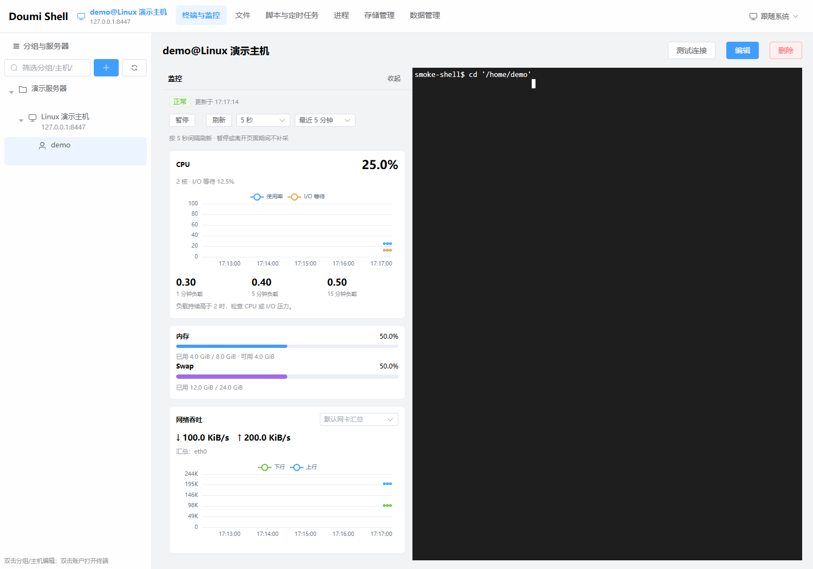
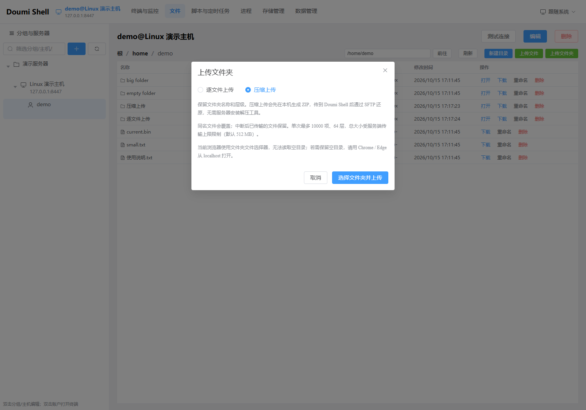
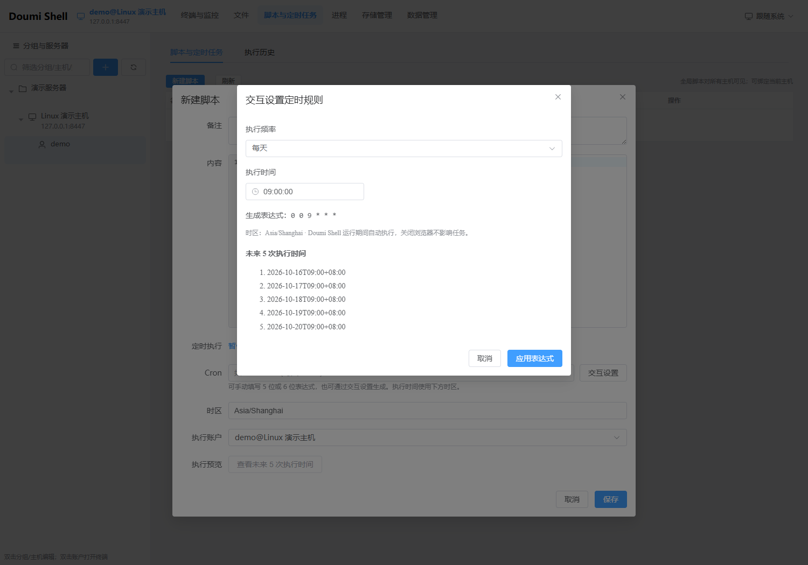
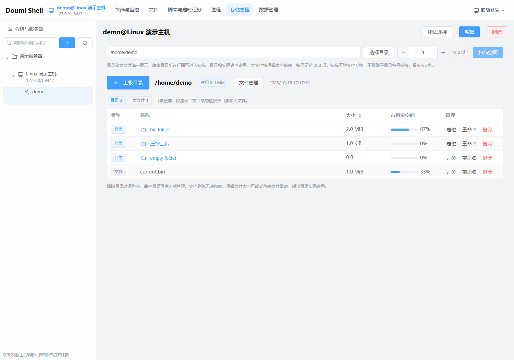

# Doumi Shell

Doumi Shell 是一款支持 Windows 和 Linux 的 SSH 服务器管理工具，为日常运维带来更优雅、顺手的操作体验。清晰的分区、细致的交互和协调的视觉设计，让终端、文件、监控、脚本与存储管理自然衔接；AI 助手进一步理解任务、分析资料并调用实际业务功能，在授权边界内协助完成复杂操作。

从服务器分组、实时终端和大文件传输，到脚本计划、进程排查与存储分析，Doumi Shell 将强大的服务器管理能力整合在一个轻快直观的界面中。本机部署后通过浏览器使用，也可部署在 Linux 服务器上供局域网设备访问。

Windows 安装包自带运行环境，Linux 压缩包需要安装 Java 17；两种部署均无需安装 Node.js 或独立数据库。适合日常服务器维护、批量保存连接信息，以及定期执行备份、巡检等 Shell 脚本。

## 主要功能

| 功能 | 可以做什么 |
| --- | --- |
| 终端与监控 | 按分组管理服务器和账户，使用 SSH 终端，查看 CPU、内存、Swap、网络和磁盘趋势 |
| 文件管理（集成于终端与监控） | 浏览远程目录，上传下载文件与文件夹，选择压缩传输，重命名和删除文件 |
| 脚本与定时任务 | 编写带语法高亮的 Shell 脚本，手动执行或交互设置 Cron，查看执行历史、输出和结束任务 |
| 进程 | 按 PID、命令或用户查找进程，正常停止或强制停止 |
| 存储管理 | 选择远程目录，统一查看目录占用和大文件，单击目录深入扫描，并定位到文件管理 |
| 数据管理 | 导入导出配置，按数据表和时间范围预览、清除本机保存的数据 |
| AI 助手 | 配置 OpenAI 兼容模型，以流式 Markdown 对话调用五个业务页面的功能，分析附件并协助导入配置 |

定时脚本由 Doumi Shell 服务端按计划执行，并使用已保存的主机地址、账户和凭据独立建立 SSH 连接；不要求浏览器保持打开，也不要求当时已有终端连接。执行记录只有在脚本内容发送完成且收到远端退出码后才会判定成功，连接中断、脚本发送失败或缺少退出码都会明确记录为失败。

界面支持浅色、深色和跟随系统主题，也可以使用自定义背景。自定义背景的不透明度统一应用于导航、侧栏、内容区、终端及弹窗，文字保持清晰。左侧“分组与服务器”侧边栏支持收起和展开，状态会在当前浏览器中自动记忆；监控面板也可调整宽度，常用界面偏好会自动记忆。

## 下载与安装

支持 **Windows 10 / 11（64 位）** 和 **Linux x64**。Windows 提供 MSI 安装包，Linux 提供包含 JAR 和启动脚本的压缩包；Linux 运行需要 Java 17（压缩包未自带运行时）。

### Windows

1. 从 [Gitee Releases](https://gitee.com/hahadoumi/web-shell/releases) 下载最新版本的 `Doumi Shell-*.msi` 并双击安装。
2. 选择安装目录，按需创建桌面和开始菜单快捷方式。
3. 安装完成时勾选 **Open Doumi Shell in browser now**，或稍后通过快捷方式启动。
4. 程序就绪后自动打开浏览器，也可以访问 **http://localhost/**。默认安装目录为 `%LOCALAPPDATA%\Programs\DoumiShell\`（用户名含中文时可另选纯英文路径）。

### Linux

1. 在 [Gitee Releases](https://gitee.com/hahadoumi/web-shell/releases) 下载最新版本的 `doumi-shell-*-linux-x64.tar.gz`。
2. 解压并进入目录，确认已安装 Java 17，然后运行启动脚本：

   ```bash
   tar -xzf doumi-shell-<版本>-linux-x64.tar.gz
   cd doumi-shell-<版本>
   chmod +x run-linux.sh
   ./run-linux.sh
   ```

3. 在部署机器上访问 **http://localhost/**。默认端口为 80，Linux 监听 80 端口通常需要 root 或相应的绑定端口权限。

Linux 启动脚本默认将数据保存在程序目录的 `data/` 中。生产环境建议设置独立的数据目录和端口，例如：

```bash
DOUMI_DATA_DIR=/var/lib/doumi-shell/data DOUMI_PORT=8080 ./run-linux.sh
```

Linux 部署后可在局域网内使用。请在服务器防火墙放行所配置的 TCP 端口，然后让同一局域网设备访问 `http://服务器局域网IP:8080/`；使用默认端口时访问 `http://服务器局域网IP/`。请只在可信网络中开放管理页面。

默认使用 80 端口，请确保没有其他程序占用。重复启动会打开已运行的页面。Windows 升级时先从系统托盘退出 Doumi Shell，再运行新安装包；安装程序会识别原安装目录。升级后网页资源会自动更新。

### 检查更新与升级

关于页面的「检查更新」由运行 Doumi Shell 的机器请求 Gitee 最新发布版本，比较本机程序版本后显示红点和对应的 Windows / Linux 下载入口。它不会自动下载、替换或安装程序；局域网访问者需要在部署机器上完成升级，仅刷新浏览器不会升级服务端。

网络超时、Gitee 限流、版本信息无效或附件未上传完整时，会明确显示「检查更新失败，无法确认是否为最新版本」，不会误报「已是最新版本」。无论检查是否成功，页面都保留直接打开 Gitee 下载页的入口。

Windows：等待传输和脚本任务结束，从系统托盘退出旧程序，运行新版 MSI 后重新启动。Linux：停止旧进程，更新程序文件，保留原数据目录、配置及启动参数，再用 Java 17 启动。程序升级后重新打开页面以加载新版资源。

## 帮助与使用教程

点击网页顶栏的 **帮助**，即可离线查看带目录导航的完整教程，涵盖服务器连接、多终端、文件传输、监控和自定义卡片、AI 助手、定时任务、配置备份及升级排错。也可直接阅读 [使用教程](docs/user-guide.md)。

## 第一次连接服务器

1. 在左侧“分组与服务器”中创建分组。
2. 在分组下添加主机，填写服务器地址和 SSH 端口，通常为 22。
3. 为主机添加账户，配置用户名及密码或私钥。
4. 选择账户，测试连接后即可使用终端、文件、监控和存储管理。

终端标签显示主机名称、IP 和账户。同一账户可重复建立终端：双击账户或选择“更多 → 新建终端”。终端支持 `Ctrl+F` 搜索，右键可查看快捷操作；选中文本后按 `Ctrl+C` 或 `Ctrl+Insert` 复制，`Shift+Insert` 或 `Ctrl+Shift+V` 粘贴。没有选中文本时 `Ctrl+C` 发送中断。

终端顶栏右上角显示 SSH / tmux 连接方式。远端 Linux 安装 tmux 后可使用持久终端会话；未安装时使用普通 SSH。监控支持多个面板，可按 `Ctrl+Space` 快捷切换。

## AI 助手

点击顶栏 **AI 助手 → 设置 → 厂商配置**，填写名称、Base URL、模型和 API Key。Base URL 通常包含 `/v1`，例如 `https://你的厂商地址/v1`；也支持完整的 `/chat/completions` 地址。模型需要支持 `tools` / function calling。可保存多个厂商配置；本地无鉴权服务可不填 API Key。点击“测试已保存配置”检查地址、模型和认证是否可用，工具调用能力可在对话中验证。

API Key 在部署机器上加密保存，编辑时留空保留旧密钥。浏览器不保存密钥。请求由部署机器发送，消息、所选附件、当前页面的服务器信息和工具结果会交给选定厂商，请按自己的数据使用要求选择服务。

对话可以查看服务器资源、文件、进程、存储和脚本，创建分组、主机与账户，也可以执行命令、编辑文件、管理定时任务及导入导出配置。AI 还可以直接为指定账户创建自定义监控指标卡片，支持状态、数值、进度、JSON、折线、柱状和饼图，卡片会自动保存到监控面板，无需手工复制脚本；每个账户最多 20 个自定义卡片。默认采用“全部权限”，AI 可直接调用已开放工具并执行写操作；可在设置中切换为“仅写操作询问”或“询问授权”，按需确认操作后执行。操作参数中的结构化凭据会遮蔽，逐项确认只在 10 分钟内有效且仅能使用一次。工具失败会显示错误，停止只阻止后续调用，已经启动的命令或脚本不会自动撤销。

通过“添加文件”或“添加文件夹”提供资料，文件夹保留相对目录。AI 可理解第三方配置并转换为通用配置快照，再经确认导入；不再提供 FinalShell 专用导入。不能识别的第三方加密凭据不会尝试当明文使用，导入后相应账户应禁用，补填凭据后再启用。导入追加到新的分组中，保留目录层级，暂停导入的定时任务，失败时回滚。

AI 助手从顶栏侧边栏呼出，默认位于左侧，可拖动移动、拖动右下角调整大小，位置和尺寸会保存在当前浏览器；支持全屏及 `Ctrl+Shift+K` 快捷键。切换业务页面时助手与当前对话继续保留。默认操作当前页面选择的主机，也可在助手内切换到其他已启用账户。顶部模型列表可选择已配置的厂商/模型，会话空闲时切换可保留当前对话历史。输入框按 Enter 发送，按 `Ctrl+Enter` 换行。AI 回复以流式方式显示，并支持 Markdown、表格、代码块和代码复制。会话消息及工具事件使用应用主密钥加密保存在本机 SQLite；点击“历史会话”可查看和恢复会话，切换服务器会恢复对应账户最近的会话。刷新页面或重启服务后仍可查看历史；服务重启时未完成的操作会标记为中断，待确认操作不会自动执行。可在“数据管理 → 清除数据”选择“AI 会话历史”按时间范围清理，正在运行或等待确认的会话受到保护。历史会话在清理前持续保留，清除厂商配置不会清除历史。附件内容会保存在加密的对话消息中，但上传文件本身、下载链接和待处理附件不跨服务重启恢复。附件单文件最多 20 MB、单会话最多 50 MB，每次最多选择 1000 个文件；大文件请使用原文件管理上传。文本附件以 UTF-8 读取，图片等二进制仅提供元信息，不提供视觉识别。单次任务最多 12 轮调用，普通 SSH 命令最多等待 60 秒，长任务请使用脚本执行历史查看。

外部 AI 客户端也可使用同一套工具目录及操作 API，见 [AI API 文档](docs/ai-api.md)。

## 界面预览

以下截图使用演示连接和测试数据。

**终端与监控**：在一个页面中操作服务器、查看资源使用趋势。



**文件与文件夹传输**：浏览远程文件，选择逐文件或压缩上传文件夹。



**交互设置 Cron**：选择执行频率与时间，预览未来 5 次执行时间。



**存储管理**：查看当前目录的直接子项，按占用定位需要清理的内容。



## 上传与下载文件夹

### 单文件传输与大文件

文件管理集成在“终端与监控”页面：左侧为监控，右上为终端，右下为文件，可拖动调整终端与文件的高度比例，也可收起文件区域。点击文件工具栏的“传输列表”打开弹窗，按当前服务器汇总不同账户和会话的任务，查看已传字节、总大小、平均速度和失败原因。按钮显示进行中的任务数量，关闭弹窗不影响传输。上传与直接写入磁盘的下载支持排队和取消，切换功能页面后任务继续执行；“清除已结束”仅清理当前服务器已结束的记录。

单文件上传按 4 MB 分块传输，每块写入远程服务器后更新进度，不受原 512 MB 单次请求限制。下载由服务端流式输出，不再将整个文件读入内存。使用支持文件保存接口的 Chrome / Edge，并通过 HTTPS 或 localhost 打开页面时，可选择本机保存位置并查看实时下载进度；其他浏览器或局域网普通 HTTP 地址使用浏览器原生下载管理器，请在那里查看下载进度和取消操作。

上传先写入同目录的独立临时文件，校验完整后替换同名目标，覆盖时保留原文件的权限位。多任务互不混写，同名目标以最后提交成功的内容为准；进入「保存中」后需等待提交结果。旧 SFTP 服务端若不支持安全覆盖，会报错并保留原文件。

大文件大小取决于本机和远程磁盘空间及文件系统限制；替换文件需要额外容纳临时文件的空间。取消或失败会尝试删除临时文件，闲置 30 分钟的任务由服务端清理；SSH 断开或程序退出时可能留下 `.doumi-upload-*.part`，可确认无进行中的上传后删除。新文件默认权限为 `600`，替换产生的新文件由当前 SSH 用户所有。暂不支持断点续传，刷新或关闭页面会中断页面内传输。浏览器接管的下载显示「已交给浏览器」，实际结果和取消由浏览器管理。以下文件夹压缩传输仍使用原有的大小和项数限制。

单文件任务在切换页面后继续运行；刷新或关闭浏览器后，从同一浏览器、同一访问地址重新打开，可查看最近 200 条历史记录和最后记录的进度，但不能自动续传。未结束的旧记录显示「无法恢复」，保存阶段离开的记录显示「结果待确认」，并提示检查目标文件。其他窗口的任务只作为历史记录展示，本页不会接管。重连 SSH 不能让原会话的任务自动续传，断线或过期会提示重新发起。关闭时浏览器会尽可能提醒尚有传输进行中；强制退出、系统终止等情况无法保证提醒。禁用本地存储或空间不足时页面会明确提示记录无法保存。文件夹对话框的进度暂不保存，重开后需检查已完成的文件再重新传输。

### 文件夹传输

进入“终端与监控”下方文件区域，点击 **上传文件夹**，选择“逐文件上传”或“压缩上传”，再选择本机文件夹。两种方式都会在远程当前目录保留所选文件夹名称、层级和内容。压缩上传先在本机生成 ZIP，由 Doumi Shell 还原后通过 SFTP 写入服务器。

在远程文件夹所在行点击 **下载**，可选“压缩下载（ZIP）”或“直接保存文件夹”。直接保存时，选择本机保存位置即可；不支持写入本机目录的浏览器会提供“无压缩 ZIP”，解压后保留原目录结构。

文件夹传输不要求远程服务器安装 zip、unzip、tar 等工具。使用最新版 Chrome / Edge 并从 `localhost` 打开页面，可保留空目录；浏览器的普通文件夹上传选择器无法读取空目录。ZIP 下载始终保留空目录。符号链接和设备等特殊文件不参与文件夹传输，遇到时会提示。

单次文件夹传输最多 10000 项、64 层，文件总大小默认不超过 512 MB。逐文件上传和压缩还原均在每个文件完整后替换同名目标；整个文件夹并非一次性提交，若中断，已完成的文件会保留。直接保存文件夹时逐文件流式写入本机；ZIP 下载仍需服务端临时磁盘和浏览器 Blob 内存。

传输流程、状态和边界详见 [文件传输说明](docs/file-transfer.md)。

## 设置脚本定时执行

进入“脚本与定时任务”，新建脚本并填写内容。支持 `bash` 和 `sh`；工作目录留空时使用远程用户主目录。

点击 Cron 旁的 **交互设置**，选择按分钟、小时、天、周或月执行，再设置具体时间、星期或日期。确认“未来 5 次执行时间”后，点击“应用表达式”。也可直接填写 5 位或 6 位 Cron 表达式。

选择执行账户和时区，打开“定时执行”开关后保存。默认时区为 `Asia/Shanghai`。按月设置 29、30、31 日时，没有该日期的月份会跳过；分钟和小时间隔按 Cron 字段边界循环，可通过执行预览核对。

在同一页面的“执行历史”页签中，可以查看全部任务的状态、输出、开始时间和耗时，也可以结束正在运行的任务。

**关闭浏览器后定时任务仍继续执行；退出 Doumi Shell、关机或休眠期间不能执行任务。重新启动后恢复计划，不补跑停机期间的任务。**

## 管理存储空间

进入“存储管理”，点击“选择目录”浏览远程文件夹，默认打开 SSH 用户主目录。设置大文件下限后点击“扫描空间”。

目录和大文件显示在同一列表中，**只显示当前目录的直接子项，名称不带路径前缀**；单击目录可继续扫描，点击“上级目录”返回。支持定位、重命名和删除文件或空目录，非空目录需要进入后管理。

子目录大小包含内部内容的实际磁盘占用，当前目录大文件显示逻辑大小。每类最多显示 200 项，一次扫描最长 85 秒，不跨文件系统、不跟随子目录符号链接。扫描功能适用于具备 GNU du/find/sort/timeout、mktemp 和 gawk/mawk 的 Linux 服务器；无权限的目录可能只能得到部分结果。

## 备份、迁移与清除数据

在“数据管理 → 配置导入导出”中，可备份分组、主机、账户凭据、脚本和定时计划，同时迁移监控卡片选择、卡片排序、刷新频率、趋势范围、网卡选择及自定义脚本指标。

- **加密备份**：设置至少 8 位密码，导入时使用相同密码。
- **明文备份**：关闭“加密备份”后导出，导入无需密码；文件包含账户密码、私钥等信息，请妥善保管。

导入会追加配置，导入的定时任务默认暂停，请检查执行账户和时间后再启用。执行历史不包含在配置备份中。

在“数据管理 → 清除数据”中，选择数据表和时间范围，先预览再确认清除。删除后无法恢复；正在执行的任务及其关联配置会受到保护。

## 退出、卸载与数据位置

- Windows：右键系统托盘图标，选择 **Open Doumi Shell** 打开页面，选择 **Exit Doumi Shell** 退出后台程序。
- Linux：在运行启动脚本的终端按 `Ctrl+C` 停止程序；使用 systemd 等服务管理器时，请通过对应服务命令停止。
- 卸载可通过 Windows“设置 → 应用”或开始菜单的 **Uninstall Doumi Shell** 进行；卸载前请先退出程序。
- Windows 数据保存在 `%LOCALAPPDATA%\DoumiShell\data`；Linux 默认保存在启动目录的 `data/`，也可通过 `DOUMI_DATA_DIR` 指定。日志位于数据目录的 `logs` 子目录。升级和卸载会保留这些数据。
- 如需直接备份整个数据目录，请先退出程序，并同时保留数据库和 `master.key`；缺失密钥将无法解密已保存的账户凭据。

网页打不开时，先确认程序已启动、访问地址和端口正确，并检查防火墙及端口是否被占用。如需修改端口，可设置环境变量 `DOUMI_PORT` 后重新启动，例如使用 8080 时访问 `http://localhost:8080/`。

安装后若提示 **Failed to launch JVM**，多为内置运行时未加载（路径含中文、杀毒隔离 `jvm.dll`、安装不完整等）。请先尝试安装目录中的 **Start Doumi Shell (Java).cmd**，或阅读 [Windows 故障排查](docs/troubleshooting-windows.md)。

源码构建和开发说明见 [开发文档](docs/DEVELOPMENT.md)。

## 使用许可（非商业）

本项目采用 [PolyForm Noncommercial 1.0.0](LICENSE)，允许非商业用途的使用、修改和分发；商业用途不在本许可授权范围内。分发时须保留许可和要求的版权声明。完整条款以 LICENSE 为准；其他授权需另行取得版权方书面许可。

禁止商用的源码许可不属于 OSI 定义的开源许可。
